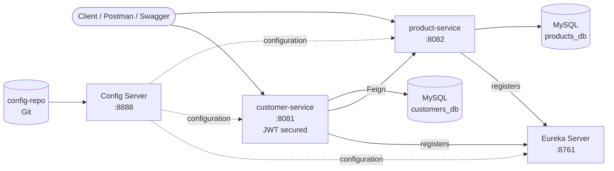
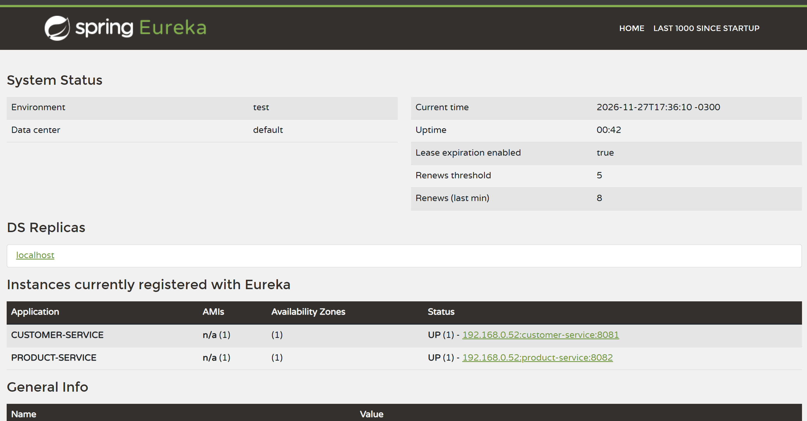
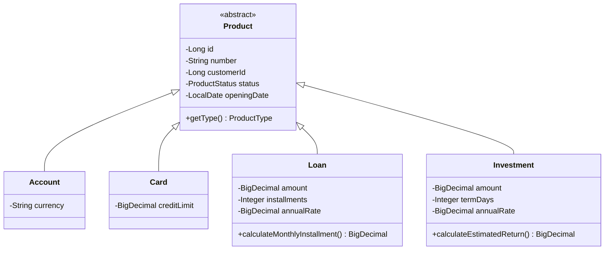
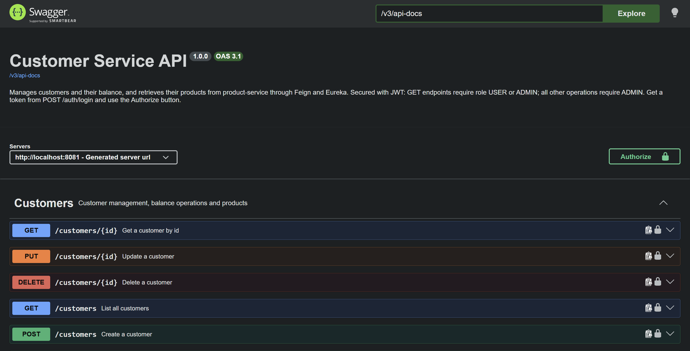
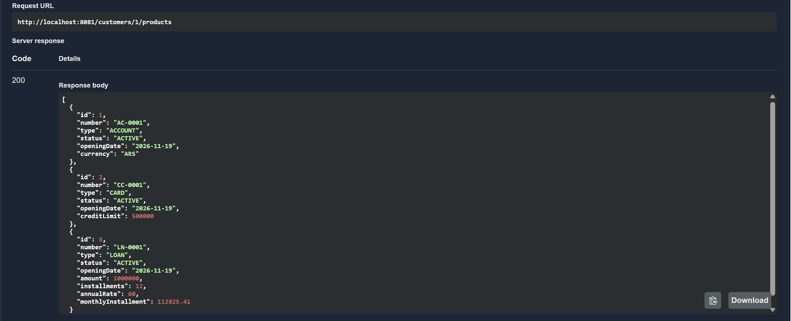
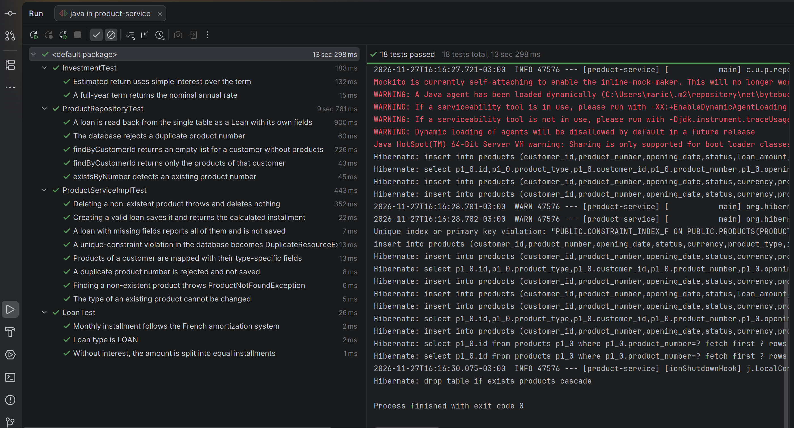
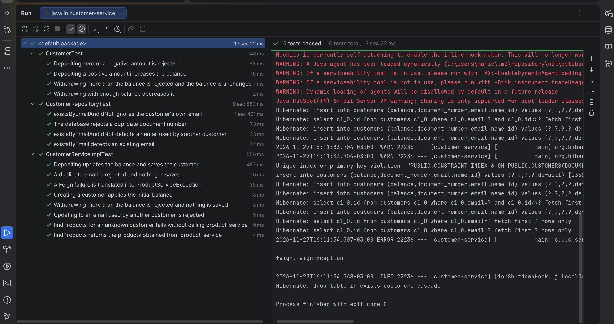

# Fintech Microservices

A microservices ecosystem for a fintech domain, built with **Java 21, Spring Boot 4 and Spring Cloud**. It manages customers and their financial products (accounts, cards, loans and investments) across independent services that share centralized configuration, discover each other through Eureka and communicate through Feign.

Final project of the *Diplomatura en Desarrollo de Software FinTech: IA y Microservicios* (UTN BA), extended with persistence in MySQL, JWT security and unit tests for portfolio purposes.

---

## Architecture



| Component | Port | Responsibility |
|---|---|---|
| **config-server** | 8888 | Serves the configuration of every service from the `config-repo/` folder of this repository |
| **eureka-server** | 8761 | Service registry: services register by name and find each other without hard-coded addresses |
| **product-service** | 8082 | Manages financial products and calculates loan installments and investment returns |
| **customer-service** | 8081 | Manages customers and their balance; retrieves their products from product-service through Feign; secured with JWT |

Both business services are registered in Eureka:



---

## Tech stack

- Java 21
- Spring Boot 4.1 (Web MVC, Data JPA, Validation, Security)
- Spring Cloud 2025.1 (Config Server, Netflix Eureka, OpenFeign)
- Spring Security OAuth2 Resource Server (JWT, HS256)
- MySQL 8
- springdoc-openapi 3.1 (Swagger UI)
- JUnit 5, Mockito and H2 (tests)
- Maven (wrapper included in each project)

---

## Repository structure

```
fintech-microservices/
├── config-repo/        Centralized configuration files (.yml) read by the Config Server
├── config-server/
├── eureka-server/
├── product-service/
├── customer-service/
├── postman/            Postman collection
└── docs/               Screenshots used in this README
```

Each service follows a layered structure: `controller`, `service` (interface + implementation), `repository`, `model`, `dto`, `mapper`, `exception` and `config`.

---

## Domain model

**product-service** uses a single-table inheritance hierarchy:



- **Loan** calculates its monthly installment with the French amortization system.
- **Investment** estimates its return with simple interest, like a fixed-term deposit.

**customer-service** stores the `Customer` with its balance, which only changes through `deposit()` and `withdraw()`.

---

## Prerequisites

- **JDK 21**
- **MySQL 8** running on `localhost:3306`. The databases `customers_db` and `products_db` are created automatically on startup.

### Environment variables

Credentials are never stored in the repository. Set these variables before starting the services:

| Variable | Used by | Description |
|---|---|---|
| `DB_PASSWORD` | product-service, customer-service | MySQL password |
| `DB_USERNAME` | product-service, customer-service | MySQL user (optional, defaults to `root`) |
| `JWT_SECRET` | customer-service | Secret used to sign JWTs (at least 32 characters) |
| `ADMIN_PASSWORD` | customer-service | Password of the `admin` user (role ADMIN) |
| `USER_PASSWORD` | customer-service | Password of the `user` user (role USER) |

**Windows (PowerShell), persistent for the current user:**

```powershell
[Environment]::SetEnvironmentVariable("DB_PASSWORD", "your_mysql_password", "User")
$secret = [Convert]::ToBase64String((1..48 | ForEach-Object { Get-Random -Maximum 256 }))
[Environment]::SetEnvironmentVariable("JWT_SECRET", $secret, "User")
[Environment]::SetEnvironmentVariable("ADMIN_PASSWORD", "your_admin_password", "User")
[Environment]::SetEnvironmentVariable("USER_PASSWORD", "your_user_password", "User")
```

Open a new terminal afterwards so the variables are available.

**Linux / macOS:**

```bash
export DB_PASSWORD="your_mysql_password"
export JWT_SECRET="$(openssl rand -base64 48)"
export ADMIN_PASSWORD="your_admin_password"
export USER_PASSWORD="your_user_password"
```

---

## How to run

The services must be started **in this order**, each one in its own terminal:

| Order | Service | Command (from the service folder) | Ready when the log shows |
|---|---|---|---|
| 1 | config-server | `./mvnw spring-boot:run` | `Started ConfigServerApplication` |
| 2 | eureka-server | `./mvnw spring-boot:run` | `Started EurekaServerApplication` |
| 3 | product-service | `./mvnw spring-boot:run` | `Started ProductServiceApplication` |
| 4 | customer-service | `./mvnw spring-boot:run` | `Started CustomerServiceApplication` |

On Windows use `.\mvnw.cmd spring-boot:run`.

After starting everything, open the Eureka dashboard at http://localhost:8761 and check that `PRODUCT-SERVICE` and `CUSTOMER-SERVICE` are registered. Feign may need up to a minute to receive the registry; until then, calls from customer-service to product-service can return 503.

---

## Centralized configuration

All service configuration lives in [`config-repo/`](config-repo):

| File | Applies to |
|---|---|
| `application.yml` | All services (Eureka address) |
| `eureka-server.yml` | Eureka Server (port, registry settings) |
| `product-service.yml` | product-service (port, datasource) |
| `customer-service.yml` | customer-service (port, datasource, Feign timeouts, JWT settings) |

Each service only keeps its name and the Config Server address locally:

```yaml
spring:
  application:
    name: product-service
  config:
    import: "configserver:http://localhost:8888"
```

The Config Server reads these files directly from this GitHub repository, so any change in `config-repo/` must be committed and pushed. Passwords appear only as placeholders (`${DB_PASSWORD}`), resolved by each service from its own environment.

---

## API documentation (Swagger)

With the services running:

- **customer-service:** http://localhost:8081/swagger-ui.html
- **product-service:** http://localhost:8082/swagger-ui.html

To call secured endpoints from Swagger, run `POST /auth/login`, copy the `accessToken` and paste it in the **Authorize** dialog.



---

## Endpoints

### product-service

| Method | Path | Description |
|---|---|---|
| GET | `/products` | List all products |
| GET | `/products/{id}` | Get a product |
| GET | `/products/customer/{customerId}` | List the products of a customer (consumed by Feign) |
| POST | `/products` | Create a product |
| PUT | `/products/{id}` | Update a product (type and owner cannot change) |
| DELETE | `/products/{id}` | Delete a product |

Required fields depend on the product type:

| Type | Required fields |
|---|---|
| `ACCOUNT` | `currency` (ARS or USD) |
| `CARD` | `creditLimit` |
| `LOAN` | `amount`, `installments`, `annualRate` |
| `INVESTMENT` | `amount`, `termDays`, `annualRate` |

Example:

```http
POST /products
Content-Type: application/json

{
  "number": "LN-0001",
  "type": "LOAN",
  "customerId": 1,
  "amount": 1000000,
  "installments": 12,
  "annualRate": 60
}
```

The response includes the calculated `monthlyInstallment` (112825.41 for this example).

### customer-service

| Method | Path | Roles | Description |
|---|---|---|---|
| POST | `/auth/login` | public | Get a JWT |
| GET | `/customers` | USER, ADMIN | List customers |
| GET | `/customers/{id}` | USER, ADMIN | Get a customer |
| GET | `/customers/{id}/products` | USER, ADMIN | Get the products of a customer, from product-service via Feign |
| POST | `/customers` | ADMIN | Create a customer |
| PUT | `/customers/{id}` | ADMIN | Update name and email |
| DELETE | `/customers/{id}` | ADMIN | Delete a customer |
| POST | `/customers/{id}/deposit` | ADMIN | Deposit money |
| POST | `/customers/{id}/withdraw` | ADMIN | Withdraw money |

`GET /customers/1/products` returns the products owned by customer 1. The request goes to customer-service, which locates product-service through Eureka and calls it with Feign:



---

## Security

customer-service is secured with **Spring Security as an OAuth2 Resource Server**:

1. `POST /auth/login` validates the username and password and returns a JWT signed with HMAC SHA-256, valid for 60 minutes.
2. Every other request must send `Authorization: Bearer <token>`.
3. The roles carried by the token decide what the request can do: `GET` endpoints require USER or ADMIN; every other operation requires ADMIN.

| Situation | Response |
|---|---|
| Missing, invalid, tampered or expired token | 401 |
| Valid token without the required role | 403 |
| Wrong username or password on login | 401 |

Two demo users are defined in memory: `admin` (ADMIN) and `user` (USER). Their passwords come from environment variables and are stored hashed with BCrypt.

---

## Error handling

Each service has a `@RestControllerAdvice` that returns errors in a uniform format:

```json
{
  "status": 404,
  "message": "Customer not found with id 99",
  "details": [],
  "timestamp": "2026-11-27T10:30:00"
}
```

| Code | Situation |
|---|---|
| 400 | Invalid data, malformed body or missing type-specific fields (listed in `details`) |
| 401 | Missing or invalid token, or wrong credentials |
| 403 | Insufficient role |
| 404 | Resource or route not found |
| 409 | Duplicate product number, email or document number |
| 422 | Insufficient balance for a withdrawal |
| 503 | product-service is unavailable (Feign call failed) |
| 500 | Unexpected error, logged without exposing internal details |

### Resilience of the Feign call

If product-service is down or does not answer, customer-service does not fail with a generic error: the `FeignException` is caught, logged, and translated into a **503** with a clear message. Feign uses explicit timeouts (2 s to connect, 5 s to read), defined in the Config Server.

---

## Tests

Unit tests with **JUnit 5**, **Mockito** and **`@DataJpaTest`**. They run without MySQL, Config Server or Eureka: a test-only `application.yml` disables Config Server and Eureka, and repository tests use an in-memory H2 database.

```bash
./mvnw test
```

| Service | Domain | Service | Repository | Total |
|---|---|---|---|---|
| product-service | 5 | 8 | 5 | **18** |
| customer-service | 4 | 8 | 4 | **16** |

- **Domain:** French-system installment, estimated return, deposits and withdrawals.
- **Service:** validations, duplicates, translation of database errors, and the Feign integration with a mocked `ProductClient` (including product-service being down).
- **Repository:** derived queries (`findByCustomerId`, `existsByEmailAndIdNot`), unique constraints and single-table inheritance mapping.





---

## Postman collection

[`postman/`](postman) contains a collection with every endpoint, including the error and security scenarios.

1. Import the collection in Postman.
2. In the collection variables, set `adminPassword` and `userPassword` (the values of `ADMIN_PASSWORD` and `USER_PASSWORD`).
3. Run the requests **in order, on empty databases**. The first two requests log in and store `adminToken` and `userToken` automatically; the rest create products and customers and then exercise the error and security scenarios.

The collection uses `{{adminToken}}` by default. Requests that test other scenarios (no token, USER role, tampered token) override the authorization on their own. Tokens expire after 60 minutes: run the login requests again when protected requests start returning 401.

Request 27 checks resilience: stop product-service before sending it to get a 503.

---

## Design decisions

- **One database per service.** product-service stores only the `customerId` of each product, with no JPA relationship to customers: customer data belongs to customer-service and is only reachable through its API.
- **One-way communication.** customer-service calls product-service, but not the other way around, to avoid a circular dependency between services. For that reason product-service does not validate that a customer exists, and returns an empty list for customers without products.
- **No remote call inside a database transaction.** The method that calls Feign runs with `Propagation.NOT_SUPPORTED`, so no database connection stays open while waiting for the network.
- **The balance is encapsulated.** `Customer` has no balance setter; separate DTOs for creating and updating prevent changing the balance through `PUT`.
- **Single-table inheritance** for products, with distinct column names for fields shared by name between subclasses (for example `loan_amount` and `investment_amount`).
- **`BigDecimal`** for every monetary value, with rounding applied only to the final result.
- **Fail fast on missing configuration.** Services use `configserver:` (not `optional:`), so they refuse to start without the Config Server instead of starting with wrong defaults.
- **`@EnableFeignClients` in its own configuration class**, so test slices like `@DataJpaTest` do not try to create Feign clients.
- **H2 is pinned to 2.3.232** (test scope only) because 2.4.240, the version managed by Spring Boot 4.1, cannot evaluate the CHECK constraint that Hibernate 7 generates for the `product_type` discriminator column.
- **Spring Cloud OpenFeign is in maintenance mode.** It is used here because the project requires it; Spring now recommends HTTP Interface clients for new code.

---

## Known limitations

- **Deleting a customer does not delete their products**, because each service owns a separate database. A production system would propagate the deletion through events or use a soft delete.
- **product-service is not secured.** It is treated as an internal service; in production it would sit behind an API Gateway.
- **Users are defined in memory.** A real system would store them in a database or delegate authentication to an identity provider such as Keycloak.
- **Eureka self-preservation** may keep a stopped service listed as UP for a while during local development.
